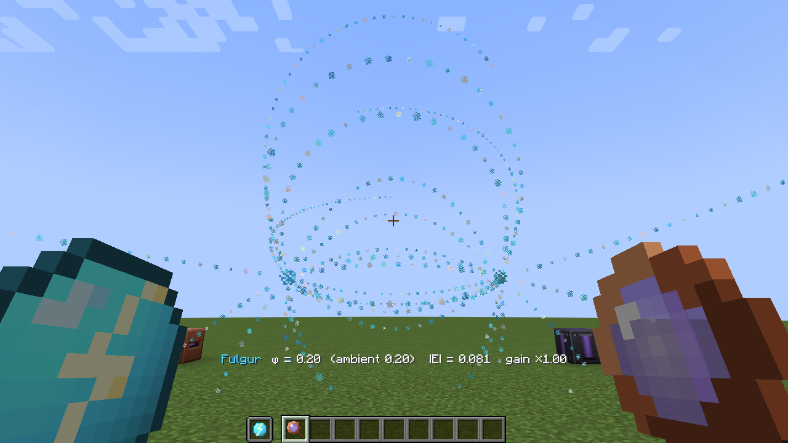

# Field Arcana（場術）

Minecraft **1.21.1 / NeoForge 21.1** 向けの魔法 Mod です。[Field Theory（場の理論）](https://github.com/nanaios/field_theory) の上に作られています。

> 火の玉は撃ちません。**場を曲げて、現象が起きるのを待つ** 魔法です。



*共鳴鏡で見た雷場の双極子（左 ＋12、右 −12）。HUD の φ が環境値 0.20 だけなのは、プレイヤーがちょうど双極子の中央面に立っているため。*

杖も機械も、やることは Field Theory の「場の層」に **源・電荷・レンズ** を書き込むことだけです。
物が飛ぶ・落ちない・感電する・別の物質に変わる、といった目に見える出来事は、すべてその場の配置から **物理として創発** します。
だから呪文同士・機械同士・自然現象（雷雨やネザーの環境場）が、設計していない組み合わせでも勝手に干渉し合います。

---

## 1. 四つの場

| 場核 | 場 | ふるまい |
|---|---|---|
| 重場核 | **Gravis（重場）** | 万物を引く。全ての物体は質量と同じ重荷を持つので、アイテムも矢も同じように落ちていく（等価原理） |
| 雷場核 | **Fulgur（雷場）** | 同符号は反発、異符号は引力。中性の物は感じない。強すぎると **絶縁破壊** |
| 結場核 | **Nexus（結場）** | 短距離で強い。場の中では空間が粘り、あらゆる運動が鈍る（**束縛**） |
| 転場核 | **Mutatio（転場）** | 力はない。ブロックを **転成** 可能な状態に開く。何に変わるかは他の場が決める |

## 2. 道具とブロック

| 名前 | レシピ（中心は全てアメジストの欠片） | 使い方 |
|---|---|---|
| **場核**（4種） | 重：黒曜石×4／雷：銅インゴット×4／結：スライムボール×4／転：グロウストーンダスト×4＋レッドストーン×4 | 杖・発生器・検場器で「どの場か」を選ぶ |
| **干渉杖** | 斜めに 棒・銅インゴット・アメジストの欠片 | 右クリックで詠唱、スニーク＋右クリックでモード切替。**もう片方の手の場核** が対象の場 |
| **共鳴鏡** | 銅インゴット×4＋棒 | 持っている間、**力線** が見え、足元の φ と \|E\| が表示される。右クリックで観測する場を切替 |
| **場発生器** | 鉄インゴット×4＋アメジスト×4＋レッドストーンブロック | 場核で右クリックして同調。**レッドストーン信号の強さに比例した電荷** の永続源になる。素手で右クリックすると極性反転 |
| **検場器** | アメジスト＋ネザークォーツ×2＋コンパレーター＋滑らかな石×3 | 場核で同調。その場所の \|φ\|（源由来）か \|E\| を **レッドストーン信号** で出力。素手で右クリックするとモード切替 |

### 干渉杖のモード

| モード | 効果 | 消費 |
|---|---|---|
| 放出＋／放出− | 視線の先に正／負の点源を置く（10 秒） | 120 |
| 付与＋／付与− | 狙った生き物（いなければ自分）に電荷を誘起する（15 秒）。その生き物自身が源になる | 100 |
| 収束 | 視線の先の半径 5 で場を ×3（場核なしなら全ての場） | 80 |
| 遮蔽 | 自分の周囲半径 3.5 で場を打ち消す（場核なしなら全ての場） | 80 |

**共鳴**（杖の魔力）は、持ち主の位置の **環境場** の強さに比例して毎秒回復します（最大 1000）。
雷雨のオーバーワールド・ネザー・地下深くでは速く、遮蔽の中では回復しません。

## 3. 現象

| 現象 | 起こる条件 | 定義元 |
|---|---|---|
| **力** | 電荷を持つ物体に `a = ±(Q/m)·E` | Field Theory |
| **束縛** | 結場のポテンシャル \|φ\| ≥ 0.5 の中で、全ての運動が毎 tick `1/(1+0.12·|φ|)` 倍に減衰 | Field Arcana |
| **絶縁破壊** | 生き物にかかる雷場応力 `|E|·(1+|Q|)` が 6 を超えると、ダメージを受け誘起雷荷を失う（火花放電） | Field Arcana |
| **転成** | 転場の源の周囲のブロックが、転場ポテンシャル（触媒）と他の場の条件を満たすと別のブロックに変わる | Field Arcana |

### 転成表（転場 ≥ 触媒 が前提）

| 入力 | 追加条件 | 出力 | 着想 |
|---|---|---|---|
| 丸石 | なし | 砂利 | 崩壊 |
| 砂利 | なし | 砂 | 崩壊 |
| 砂 | 雷場 ≥ 3 | ガラス | フルグライト（落雷が砂を溶かす） |
| 赤い砂 | 雷場 ≥ 3 | 橙色の色付きガラス | 同上 |
| 酸化した銅 → 錆びた銅 → 風化した銅 → 銅ブロック | 雷場 ≥ 3 | 1 段階戻る | 落雷による脱酸化 |
| ネザーラック | 雷場 ≥ 4 | マグマブロック | 放電加熱 |
| 丸石 | 重場 ≥ 5 | 深層岩の丸石 | 圧縮 |
| 石レンガ | 重場 ≥ 4 | ひび割れた石レンガ | 応力 |
| 氷 → 氷塊 → 青氷 | 重場 ≥ 5 / ≥ 9 | 圧縮 | 圧密 |
| 泥 | 結場 ≥ 2 | 粘土 | 結合 |
| 丸石 | 結場 ≥ 3 | 苔むした丸石 | 結合 |
| 石炭ブロック | 重場 ≥ 9 かつ 結場 ≥ 4（触媒 3） | 深層ダイヤモンド鉱石 | 高圧下の炭素 |

ポテンシャルは **環境場込み** なので、雷雨（雷場の環境値 +3.8）の中なら転場の源を置くだけで砂がガラスになります。
条件の多いレシピが優先されます。データパックで追加できます（`data/<ns>/field_arcana/transmutation/*.json`）。

```json
{ "input": "minecraft:sand", "output": "minecraft:glass", "catalyst": 1.5,
  "conditions": [ { "field": "field_theory:fulgur", "min": 3.0 } ] }
```

`input` はブロック ID かタグ（`#minecraft:logs`）、`conditions` は `min` / `max` を持てます。

## 4. 遊び方の例

- **重力井戸**：重場を放出すると、周囲のアイテムや経験値が吸い込まれる。井戸の横を飛ぶ矢は曲がる。
- **斥力の鎧**：自分に雷荷＋を付与し、敵にも雷荷＋を付与すると、互いに押し退け合う。クリーパーは元々雷荷＋を持っている。
- **火花放電**：敵に雷荷−を付与し、近くに雷場＋を放出すると、敵は引き寄せられて絶縁破壊を起こす。
- **緩降**：結場を足元に放出して落下を止める。追ってくる敵を結場の中で足止めする。
- **無線レッドストーン**：場発生器と検場器を同じ場に同調させれば、離れた場所に信号が届く（距離で減衰する）。検場器の出力を発生器に戻せば発振器になる。
- **圧縮工場**：転場の発生器と重場の発生器を並べると、丸石が深層岩の丸石に変わり続ける。
- **双極子レンズ**：共鳴鏡で見ながら正負の源を並べると、力線が + から − へ弧を描く。収束を重ねると力線が詰まる。

## 5. 開発

Field Theory に依存しているので、先にそちらを Maven Local に公開します。

```bash
# 1. ライブラリ
cd field_theory && ./gradlew publishToMavenLocal

# 2. 本体
cd ../field_arcana
./gradlew build
./gradlew runGameTestServer         # ゲーム内テスト（ヘッドレス）
./gradlew runClient                 # クライアント
./gradlew runClient -PquickPlay=<セーブ名>   # 既存のシングルプレイワールドへ直接入る
```

GitHub から直接ビルドする場合は `-Pfield_theory_coordinates=com.github.nanaios:field_theory:<commit>`（JitPack）も使えます。

GameTest（`gametest/ArcanaGameTests.java`）では、実サーバー上で次を検証しています。

- 砂は転場だけでは変わらず、雷場が加わるとガラスになる
- 同じ丸石が、転場だけなら砂利、重場が加わると深層岩の丸石になる
- レッドストーンで動く場発生器を 4 ブロック先の検場器が読み取り、信号を切ると沈黙し、壊すと源が消える
- 結場の中では落下が大きく遅くなる
- 異符号に帯電した生き物は雷源に引き寄せられ、絶縁破壊でダメージを受けて放電する
- 干渉杖の放出で源ができ、付与（対象なし）で術者自身が帯電する

## ライセンス

未定（現在は `All Rights Reserved`）。公開方針に合わせて `gradle.properties` の `mod_license` を変更してください。
